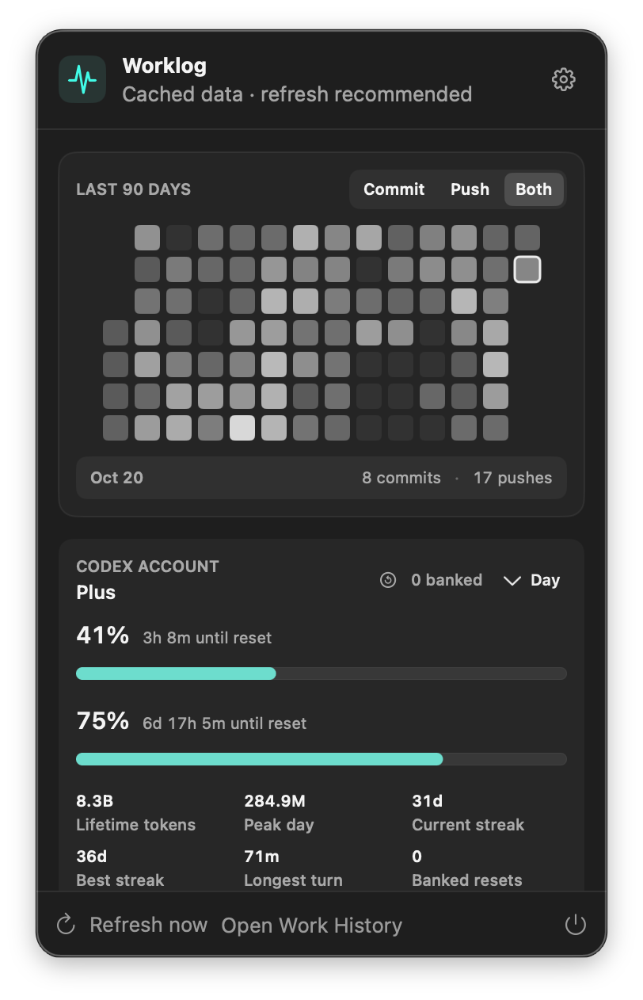

# Worklog

A local macOS menu-bar and Windows tray app for keeping track of GitHub commits, pushes, and Codex usage.

This was inspired by [CodexBar](https://github.com/steipete/CodexBar), but I also wanted to keep track of my GitHub commits and pushes. Mostly, I wanted to try building my own menu-bar app. This is my first one, and it seemed like a good opportunity to learn.

I'm sharing it as-is in case anyone else wants it. If it's useful, take it. If you want something different, fork it and have your agents, or yourself, make it work the way you want. There's no promise of ongoing support or a release schedule. You don't need to wait on me to change your copy.



The macOS menu-bar app with my current data, captured October 20, 2026.

## What it does today

- Keeps a local SQLite ledger of commits and push activity across repositories accessible to your GitHub CLI account.
- Shows Day, rolling Week, rolling Month, Year, and All summaries in a native macOS menu-bar popover or Windows tray flyout.
- Includes a clickable grayscale heatmap for the trailing 90 days, with Commit, Push, and Both modes.
- Opens a searchable monthly Work History in your browser.
- Records local Codex session metadata and observed token counters, with repository attribution when a GitHub remote can be resolved.
- Shows the signed-in Codex account's available rate-limit windows, reset countdowns, usage facts, credits, and banked resets.
- Refreshes through one local background service and keeps the last successful snapshot available when that service is temporarily unavailable.

Week includes today and the previous six local calendar days. Month includes today and the previous 29.

## Build it yourself

This is a source-only project. There is no downloadable app release.

### Windows

Requires 64-bit Windows 10/11, the .NET 9 SDK (including the Desktop Runtime), Node.js 24+, pnpm 11, and GitHub CLI. Authenticate with `gh auth login`; sign in with `codex login` for Codex account usage. Local session collection needs an existing Codex state index.

From PowerShell:

```powershell
git clone https://github.com/jimmytheghost/worklog.git
Set-Location worklog
pnpm install --frozen-lockfile
pnpm build
powershell -ExecutionPolicy Bypass -File apps/windows/scripts/package-app.ps1
Start-Process apps/windows/dist/Worklog.exe
```

The native WPF app lives in the notification area. Left-click its icon to toggle the 360-unit flyout; right-click for Open, Refresh, Work History, Settings, or Quit. Its charcoal surfaces and mint accents follow [Tipoff](https://github.com/jimmytheghost/tipoff) and macOS Worklog. Account facts use compact inline pairs in two columns. Local tokens, commits, pushes, active days, and projects share a single row; selected range and heatmap buttons use dark text on mint. The gear opens startup settings and the explanation of local token counters and partial push coverage. Start with Windows is off by default.

Packaging records the checkout and Node paths. Keep both available and repackage if they move. This is an unsigned source build with no standalone installer or automatic updater. To update, quit the tray app, pull changes, repeat the install/build/package commands, and relaunch. Quitting the tray leaves the shared service running; see [Windows build, service restart, cache, and validation notes](apps/windows/README.md) before updating service code.

### macOS

Requirements:

- macOS 14 or newer for the native app.
- Xcode Command Line Tools with Swift 5.9 or newer (`xcode-select --install`).
- Node.js 24 or newer and pnpm 11 (the repository pins pnpm 11.18.0).
- GitHub CLI, authenticated with `gh auth login`.
- Codex CLI, signed in with `codex login`, for Codex account usage. Local session collection also needs an existing Codex state index.

```sh
git clone https://github.com/jimmytheghost/worklog.git
cd worklog
pnpm install --frozen-lockfile
pnpm build
apps/macos/scripts/package-app.sh
open apps/macos/dist/Worklog.app
```

The package script builds a native app for your machine and signs it ad hoc. It does not create a notarized, standalone distribution: the app remembers this checkout's location and needs the checkout and command-line tools to run. Repackage if you move the checkout. Intel and other machines have not been independently verified for this sharing pass.

The app starts or reuses the service at `http://127.0.0.1:4317`. It refreshes GitHub every 15 minutes and Codex every five minutes by default. Click Refresh to request an update sooner. GitHub's first import can take a while for accounts with many repositories.

Double-click `launch.command` to open the browser dashboard directly. It installs and builds missing dependencies on first launch. The native app's Settings include an option to start at login. See [the native app notes](apps/macos/README.md) for more detail.

To update, quit Worklog from its popover, pull the changes, and repeat the install, build, and package commands. Quitting the menu-bar app leaves the background service running. Stop the service process recorded in `~/.agent-dashboard/service.pid` before restarting if you need updated service code to take effect; check that the PID still belongs to Worklog first.

## Where it's at

This is a personal work ledger with a few limits that affect what the numbers mean:

- **GitHub coverage:** collection walks live branches in accessible owned, collaborator, and organization-member repositories, deduplicating commits by repository and SHA. It uses your existing CLI permissions, including access to private repositories. Push history is partial because GitHub's activity sources do not expose unlimited historical events. Commit and push counts stay separate.
- **Codex coverage:** local session formats are unsupported and may change. The adapter labels its coverage experimental and partial. Observed session token counters are separate from account limits and are not billing-grade totals. Missing fields stay unavailable.
- **Personal defaults:** reporting uses `America/Denver` unless you set `SERVICE_TIMEZONE` when starting the service. Both native clients expect port 4317. Configuration lives in [the service config](apps/service/src/config.ts); launchers inherit environment variables and do not load a `.env` file.
- **Local service:** the API binds to `127.0.0.1` by default and has no authentication. Keep it local. It exposes repository names, commit subjects, activity, and usage data to local clients.

There is no telemetry. Worklog makes read-only requests to GitHub through `gh` and asks the local Codex app-server for account information using the existing Codex login. It also reads local Codex files to extract an explicit metadata allowlist. It does not retain source code, prompts, responses, commands, tool output, commit bodies, diffs, or file lists in its ledger. Commit subjects and canonical GitHub links are retained. Worklog does not store Codex credentials or the account email; it stores an account hash and the displayed usage snapshot.

The database lives at `~/.agent-dashboard/agent-dashboard.sqlite` on both platforms. The macOS launcher writes `~/.agent-dashboard/service.log`, and its native app caches its last snapshot in your user Application Support directory. The Windows app caches decoded display fields at `%LOCALAPPDATA%\Worklog\snapshot.json`; its launcher drains service output without saving it. These local files can contain private project metadata, so review them before sharing logs or screenshots.

## Make it yours

Start with [AGENTS.md](AGENTS.md) and [the handoff](docs/handoff.md). The [product brief](docs/product-brief.md), [architecture](docs/architecture.md), [data contract](docs/data-contract.md), and [design notes](docs/design-direction.md) explain the existing choices.

- [`apps/macos/Sources/AgentDashboardMenuBar`](apps/macos/Sources/AgentDashboardMenuBar): native popover, heatmap, settings, and cached API state.
- [`apps/windows`](apps/windows): Windows WPF tray flyout, service launcher, snapshot cache, and startup settings.
- [`apps/dashboard/src`](apps/dashboard/src): browser dashboard and monthly history.
- [`apps/service/src`](apps/service/src): local routes, refresh coordination, and summaries.
- [`packages/collector-github`](packages/collector-github) and [`packages/collector-codex`](packages/collector-codex): source adapters.
- [`packages/domain`](packages/domain) and [`packages/storage`](packages/storage): event contracts and SQLite ledger.

For browser development:

```sh
pnpm dev
```

The dashboard runs at `http://127.0.0.1:5173`; the API remains at `http://127.0.0.1:4317`. To request an initial import during development:

```sh
curl --request POST http://127.0.0.1:4317/api/sync/github
curl --request POST http://127.0.0.1:4317/api/sync/codex
```

Validation commands for code changes:

```sh
pnpm test
pnpm typecheck
pnpm build
```

For native macOS changes, also run `swift test --package-path apps/macos` on macOS. For Windows changes, run:

```powershell
dotnet run --project apps/windows/Worklog.Tests --configfile apps/windows/NuGet.Config
dotnet build apps/windows/Worklog.App --configfile apps/windows/NuGet.Config
```

See [the source-sharing review](docs/public-release-review.md) for the preparation checks and their scope.

## License

The code is available under the [MIT License](LICENSE), with permission to use, modify, and redistribute it under those terms. It's provided as-is, without warranty.

CodexBar is credited as the inspiration. GitHub, OpenAI, and Codex names and marks belong to their respective owners; this project is independent of them. The license covers this project's code, not third-party service data or marks.
